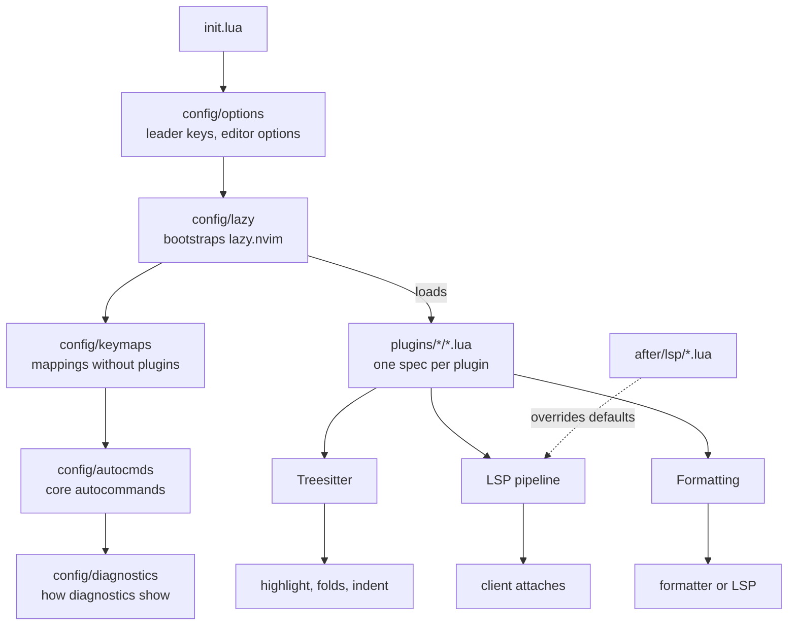
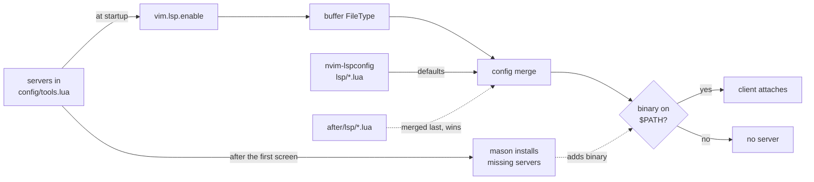
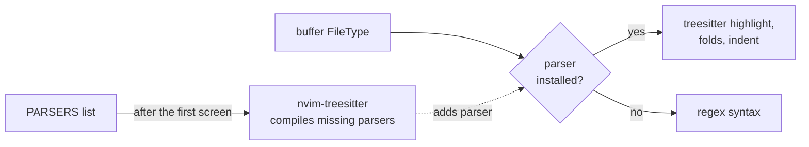

# Architecture

This page shows how the config fits together: what runs at startup, how plugins load, how the LSP, Treesitter and formatting pipelines work, and where to make common changes. For the details of a single option or plugin, read the header comment of the file it lives in.

## Overview



[`init.lua`](../init.lua) requires the `config/` modules in the order shown. Options run first so plugins see the leader keys. Nothing in `lua/config/` depends on a plugin, so the editor still works if a plugin fails to load. [`tools.lua`](../lua/config/tools.lua) isn't in the chain: the LSP specs `require` it.

The LSP pipeline, Treesitter and Formatting nodes each have their own section below.

## Directory layout

```text
~/.config/nvim/
├── init.lua                  entry point: requires the lua/config/ modules in order
├── lua/
│   ├── config/               editor setup that doesn't depend on any plugin
│   │   └── tools.lua         servers, formatters and linters to install
│   └── plugins/
│       └── <category>/       plugins grouped by what they do
│           ├── init.lua      empty spec; its header says what belongs here
│           └── <plugin>.lua  one spec per plugin
├── after/                    loaded last on the runtime path, so its files override plugin defaults
│   └── lsp/<server>.lua      per-server overrides
├── stylua.toml               Lua formatting rules
└── lazy-lock.json            pinned plugin commits
```

## How plugins load

[`lua/config/lazy.lua`](../lua/config/lazy.lua) imports each category with its own `{ import = "plugins.<category>" }` line, because lazy.nvim doesn't look inside subfolders of `lua/plugins/`. The empty `init.lua` keeps the import working while the folder has no plugin.

Plugins load at startup unless the spec gives lazy.nvim a trigger to wait for:

- `event`: an autocommand event, such as `InsertEnter`
- `ft`: a filetype
- `keys`: the first press of one of the spec's keymaps
- `cmd`: the first use of one of the plugin's commands

Plugins track their latest commit, not their release tags (`version = false`). `lazy-lock.json` records which commit is installed.

## LSP pipeline

A server starts on the first buffer of one of its filetypes, if its binary is installed:



- [`lspconfig.lua`](../lua/plugins/lsp/lspconfig.lua) enables at startup, so a file opened with `nvim file` gets its server. [mason-tool-installer](../lua/plugins/lsp/mason-tool-installer.lua) installs later, along with the formatters and linters. On a first start, buffers opened before their server is installed have no client until you reopen them with `:e`.
- Entries are lspconfig names: `lua_ls`, not `lua-language-server` (`:help lspconfig-all`). A server installed from `:Mason` but missing from the list is not enabled.
- Once a client attaches, Neovim's [default LSP keymaps](keymaps.md#lsp) apply.

Check with `:checkhealth vim.lsp`.

## Treesitter

Treesitter parses each buffer into a syntax tree, which Neovim uses for highlighting, folds and indent that follow the code's structure:



- `PARSERS` in [`nvim-treesitter.lua`](../lua/plugins/treesitter/nvim-treesitter.lua) holds language names, not filetypes: `tsx` for `typescriptreact`. For the current buffer: `:lua =vim.treesitter.language.get_lang(vim.bo.filetype)`. Neovim already bundles parsers for a few languages.
- Compiling needs the tree-sitter CLI and a C compiler. `build = ":TSUpdate"` recompiles parsers when the plugin updates. As with servers, a buffer opened before its parser is installed keeps regex syntax until `:e`.
- The other plugins in `lua/plugins/treesitter/` build on the same syntax tree.

Check with `:checkhealth nvim-treesitter`.

## Formatting

[conform.nvim](../lua/plugins/coding/conform.lua) runs the formatter listed for the buffer's filetype. When none is listed or available, it asks the language server instead. prettier is available only in projects with a Prettier config; elsewhere its filetypes fall back to the language server.

A tool that is both a formatter and a language server goes in one of the two lists in [`config/tools.lua`](../lua/config/tools.lua):

```lua
local SERVERS = {
  -- Also lints, so it runs as a server. `after/lsp/ruff.lua` turns off its
  -- formatting.
  "ruff",
}

local FORMATTERS = {
  -- Formatter only: installed, never started as a server.
  "stylua",
}
```

## Common changes

Restart Neovim after each change. lazy.nvim, mason and nvim-treesitter install anything new in the background.

| Change | Files | Check |
| --- | --- | --- |
| [Add a plugin](../STYLE.md#plugin-example) | `lua/plugins/<category>/<plugin>.lua`, `docs/keymaps.md` | `:Lazy` |
| [Add a plugin category](#add-a-plugin-category) | `lua/plugins/<category>/init.lua`, `lua/config/lazy.lua` | `:Lazy` |
| [Add a language server](#lsp-pipeline) | `servers` in `lua/config/tools.lua` | `:checkhealth vim.lsp` |
| Override a server's settings | `after/lsp/<server>.lua` | `:checkhealth vim.lsp` |
| [Add a formatter](#add-a-formatter) | `lua/plugins/coding/conform.lua`, `lua/config/tools.lua` | `:ConformInfo` |
| [Add a linter](#add-a-linter) | `linters` and `servers` in `lua/config/tools.lua` | Its warnings (`]d`) |
| [Add a treesitter parser](#treesitter) | `PARSERS` in `lua/plugins/treesitter/nvim-treesitter.lua` | `:checkhealth nvim-treesitter` |

An override returns only the keys to change, as [`after/lsp/ruff.lua`](../after/lsp/ruff.lua) does.

### Add a plugin category

```lua
-- lua/plugins/debug/init.lua
---Debug plugins: running and stepping through programs.

---@type LazySpec
return {}
```

```lua
-- lua/config/lazy.lua
spec = {
  -- ...
  { import = "plugins.debug" },
},
```

### Add a formatter

shfmt is wired up in two files:

```lua
-- lua/plugins/coding/conform.lua
formatters_by_ft = {
  sh = { "shfmt" },
},
```

```lua
-- lua/config/tools.lua
local FORMATTERS = {
  "shfmt", -- shell scripts
}
```

The two names can differ: conform's `ruff_format` runs mason's `ruff`. If the tool is also a server, see [Formatting](#formatting).

### Add a linter

Nothing in this config starts a linter, so it needs a server that runs it:

```lua
-- lua/config/tools.lua
local SERVERS = {
  "bashls", -- runs shellcheck and shows its warnings
}

local LINTERS = {
  "shellcheck", -- installed only
}
```
